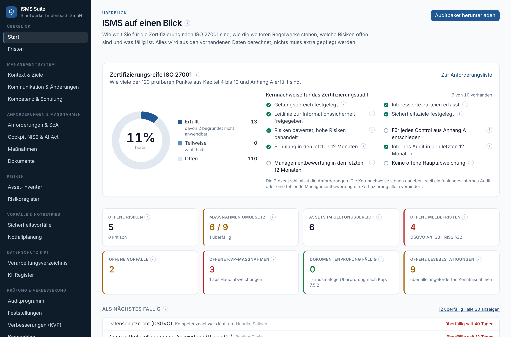

# ISMS-Suite für ISO 27001

**Ihr Managementsystem für Informationssicherheit nach ISO 27001. NIS2, DSGVO, BSI
IT-Grundschutz und EU AI Act kommen obendrauf, ohne dass Sie etwas doppelt pflegen.**



## Auf einen Blick

**Im Mittelpunkt steht ISO 27001:2022.** Die Suite ist so aufgebaut, wie ein Auditor die Norm
im Zertifizierungsaudit durchgeht: Für jeden der 123 prüfbaren Punkte (Kapitel 4 bis 10 und die
93 Maßnahmen aus Anhang A) gibt es einen Platz. Die Startseite zeigt in Prozent, wie weit Sie
für die Zertifizierung sind, und welche Kernnachweise noch fehlen.

**Obendrauf kommen weitere Regelwerke.** Jedes dockt an dieselben Maßnahmen, Risiken und
Nachweise an, die Sie für ISO 27001 ohnehin pflegen:

| Regelwerk              | Was die Suite dafür ergänzt                                                                                                                                         |
| ---------------------- | ------------------------------------------------------------------------------------------------------------------------------------------------------------------- |
| **NIS2 / BSI-Gesetz**  | Ein Cockpit zeigt jede Pflicht nach § 30 BSIG und welche ISO-27001-Maßnahmen sie schon erfüllen. Dazu die Meldefristen nach 24 Stunden, 72 Stunden und einem Monat. |
| **DSGVO**              | Verarbeitungsverzeichnis und Datenschutz-Folgenabschätzung. Die technischen und organisatorischen Maßnahmen sind dieselben wie im ISMS.                             |
| **BSI IT-Grundschutz** | Modellierung der zutreffenden Bausteine und der IT-Grundschutz-Check, beides aus denselben Maßnahmen.                                                               |
| **EU AI Act**          | Ein KI-Register für die KI-Systeme, die Sie einsetzen, mit den Pflichten als Betreiber.                                                                             |

Das Prinzip dahinter: **Eine Maßnahme, einmal erfasst, zählt in jedem Regelwerk.** Die
Mehrfaktor-Anmeldung für Administratoren erfüllt ISO 27001 A.5.17, einen IT-Grundschutz-Baustein
und eine NIS2-Pflicht zugleich. Die Suite schlägt die passenden Anforderungen der anderen
Regelwerke selbst vor.

**Für wen:** ISMS-Leitung und Informationssicherheitsbeauftragte, Datenschutzbeauftragte,
interne Auditorinnen und Auditoren und alle, die für Systeme oder Risiken verantwortlich sind.

## Schnellstart mit Docker

Sie brauchen nur **Docker Desktop** (kostenlos für Privatpersonen und kleine Unternehmen). Der
erste Start dauert einige Minuten, jeder weitere geht in Sekunden.

1. **Docker Desktop installieren**: von <https://www.docker.com/products/docker-desktop/>
   herunterladen, installieren und starten. Unter Windows richtet der Installer alles Nötige mit
   ein; danach einmal neu starten.
2. **Die Suite herunterladen**: auf GitHub oben rechts **Code → Download ZIP**, die Datei
   entpacken. Oder mit Git: `git clone https://github.com/Kico-bot/ISMS_SaaS.git`
3. **Ein Terminal im Ordner der Suite öffnen**
   - Windows: im Ordner Rechtsklick → **Im Terminal öffnen**
   - Mac: Programm **Terminal** öffnen, `cd ` eintippen (mit Leerzeichen), den Ordner ins
     Fenster ziehen, Enter
4. **Zwei geheime Schlüssel erzeugen.** Die Suite startet nicht mit den Beispielwerten aus dem
   Quellcode, denn die kennt jeder. Diese Befehle legen eigene Schlüssel in der Datei `.env` ab:

   Mac und Linux:

   ```bash
   echo "ISMS_JWT_SECRET=$(openssl rand -base64 48)" >> .env
   echo "ISMS_APP_MASTER_KEY=$(openssl rand -base64 32)" >> .env
   ```

   Windows (PowerShell, das Terminal aus Schritt 3):

   ```powershell
   function Get-Secret($n) { $b = New-Object byte[] $n; [Security.Cryptography.RandomNumberGenerator]::Create().GetBytes($b); [Convert]::ToBase64String($b) }
   Add-Content .env "ISMS_JWT_SECRET=$(Get-Secret 48)"
   Add-Content .env "ISMS_APP_MASTER_KEY=$(Get-Secret 32)"
   ```

5. **Starten:**

   ```bash
   docker compose up -d --build
   ```

6. **Im Browser öffnen:** <http://localhost:8080>
7. **Anmelden.** Die Suite bringt einen ausgefüllten Beispielmandanten mit, die erfundene
   **Stadtwerke Lindenbach GmbH**. Kennwort für alle Konten: `demo-passwort-2026-lindenbach`

   | Anmeldung als                        | sieht die Suite als …                    |
   | ------------------------------------ | ---------------------------------------- |
   | `henrike.sallach@lindenbach.example` | ISMS-Leitung, darf fast alles            |
   | `jorin.kessler@lindenbach.example`   | Stellvertretung, gibt Dokumente frei     |
   | `bastian.olwig@lindenbach.example`   | Verantwortlicher für Systeme und Risiken |
   | `corinna.feldt@lindenbach.example`   | Interne Auditorin, prüft, ändert nicht   |
   | `ilka.norgaard@lindenbach.example`   | Datenschutzbeauftragte                   |

8. **Beenden:** `docker compose down`. Die Daten bleiben erhalten. Mit `docker compose down -v`
   wird alles verworfen, und der nächste Start beginnt frisch.

Klappt etwas nicht? Die häufigsten Ursachen und ihre Lösung stehen in der
[Fehlersuche](docs/deployment.md#9-fehlersuche). Für den echten Betrieb mit eigenen Daten
(Demodaten aus, TLS, Datensicherung) gibt es eine
[Checkliste](docs/deployment.md#7-vom-vorführ--in-den-produktivbetrieb).

## Start für die Entwicklung

Mit Neuaufbau bei jeder Änderung. Sie brauchen Node 22, pnpm 10 und Docker (oder eine eigene
PostgreSQL 16).

```bash
cp .env.example .env
docker compose -f infra/docker/docker-compose.yml up -d   # nur PostgreSQL und Testpostfach
pnpm install
pnpm -r build
pnpm db:migrate && pnpm db:seed && pnpm db:seed:demo      # Schema, Kataloge, Beispielmandant
pnpm dev                                                  # API auf :3000, Oberfläche auf :5173
```

Danach im Browser <http://localhost:5173> öffnen und mit einem der Konten oben anmelden. Tests:
`pnpm -r test`. Mehr dazu in der [technischen Dokumentation](docs/technik.md).

## Rundgang durch die Demo

1. **Startseite:** die Zertifizierungsreife nach ISO 27001 als Ring, daneben die Kernnachweise
   für das Zertifizierungsaudit und was als Nächstes fällig ist.
2. **Anforderungen & SoA:** jeder Punkt der ISO 27001 als Zeile, ob er gilt, wie weit er
   umgesetzt ist und womit. Daraus entsteht die Anwendbarkeitserklärung (SoA).
3. **Maßnahmen →** „Mehrfaktor-Anmeldung …“ öffnen: eine Maßnahme, drei Regelwerke.
4. **Risikoregister:** die 5×5-Matrix; ein Risiko öffnen und die Bewertung ansehen.
5. **Sicherheitsvorfälle:** der Fristenmonitor zeigt eine überfällige NIS2-Meldung.
6. **Cockpit NIS2 & AI Act:** jede NIS2-Pflicht mit BSIG-Paragraf und womit sie erfüllt ist.
7. **Startseite → Auditpaket herunterladen:** alle Register und Nachweise in einer ZIP-Datei.

Dann abmelden und als **Corinna Feldt** wieder anmelden: dieselbe Suite aus Sicht der
Auditorin. Sie sieht alles, ändert aber nur Audits und Feststellungen.

## ISO 27001 Kapitel für Kapitel

So verteilt sich die Norm auf die Bereiche der Suite. Welcher Normpunkt genau wo erfasst wird,
steht vollständig in [`docs/iso27001-abdeckung.md`](docs/iso27001-abdeckung.md).

| Kapitel                    | Wo in der Suite                                                             |
| -------------------------- | --------------------------------------------------------------------------- |
| 4 Kontext der Organisation | Kontext & Ziele: Umfeld, interessierte Parteien, Geltungsbereich            |
| 5 Führung                  | Dokumente (Leitlinie mit Freigabe), Organigramm, Rollen                     |
| 6 Planung                  | Risikoregister, Anwendbarkeitserklärung, Sicherheitsziele, Änderungsplanung |
| 7 Unterstützung            | Kompetenz & Schulung, Kommunikationsplan, Dokumente mit Lesebestätigung     |
| 8 Betrieb                  | Maßnahmen, Risikobehandlung, Notfallplanung                                 |
| 9 Bewertung der Leistung   | Kennzahlen, Auditprogramm, Managementbewertung                              |
| 10 Verbesserung            | Feststellungen, Korrekturmaßnahmen (KVP)                                    |
| Anhang A (93 Maßnahmen)    | Anforderungsliste mit zugeordneten Maßnahmen und Nachweisen                 |

## Darauf können Sie sich verlassen

- **Vier-Augen-Prinzip:** Wer ein Dokument schreibt, gibt es nicht selbst frei. Wer ein Risiko
  verantwortet, nimmt es nicht selbst an. Das gilt nicht nur in der Oberfläche, sondern ist in
  der Datenbank verankert.
- **Rollen:** Jede Person sieht und bearbeitet nur, was zu ihrer Aufgabe gehört. Eine
  Auditorin prüft, ändert aber nicht das ISMS.
- **Lückenloses Änderungsprotokoll,** das auch die ISMS-Leitung nicht nachträglich glätten kann.
- **Bereit fürs Audit:** Ein Klick liefert alle Register als Excel-lesbare Tabellen und alle
  Nachweise im Original, für den Termin, in dem jemand sagt: „Zeigen Sie mir Ihr ISMS.“
- **Hilfe direkt am Feld:** Ein kleines i neben jedem Eingabefeld zeigt, welcher Normpunkt
  dahintersteckt, und erklärt Abkürzungen.
- **Eigener Betrieb, keine Lizenzkosten im eigenen Haus:** läuft auf einem eigenen Rechner oder
  Server und baut ausschließlich auf quelloffener Software auf.

## Weiterführende Dokumentation

| Dokument                                                      | Für wen und wofür                                               |
| ------------------------------------------------------------- | --------------------------------------------------------------- |
| [ISO 27001: Wo wird was erfasst?](docs/iso27001-abdeckung.md) | Alle 123 Normpunkte und ihr Platz in der Suite                  |
| [Deployment und Betrieb](docs/deployment.md)                  | Inbetriebnahme, Einstellungen, Datensicherung, Produktivbetrieb |
| [Technische Dokumentation](docs/technik.md)                   | Aufbau, Entwicklung, Tests, Demodaten, Hintergrundaufträge      |
| [Architektur](docs/architecture/)                             | Datenmodell und Backend-Architektur mit Begründung              |
| [Screenshots aller Bereiche](docs/produkt-screenshots/)       | Bilder der Oberfläche, mit Vorschlag für eine Vorführung        |
| [Offene Punkte](docs/offene-punkte.md)                        | Prüfaufträge und bekannte Lücken                                |
| [Lizenzierung](LIZENZIERUNG.md)                               | Was kostenlos erlaubt ist und wofür es eine Lizenz braucht      |

## Lizenz

Copyright (C) 2026 Kristian Dabic. Die Suite steht unter der
**[PolyForm Internal Use License 1.0.0](LICENSE)**:

- **Kostenlos** für den Einsatz im eigenen Haus, für Unternehmen, Behörden, Vereine und
  Privatpersonen, einschließlich eigener Anpassungen.
- **Kostenpflichtig** für alle, die die Suite bei Kunden einsetzen (Beratung,
  IT-Dienstleistung), sie für andere betreiben oder sie weitergeben oder verkaufen.

Die Einzelheiten und wie Sie eine Lizenz anfragen, stehen in
[LIZENZIERUNG.md](LIZENZIERUNG.md).
