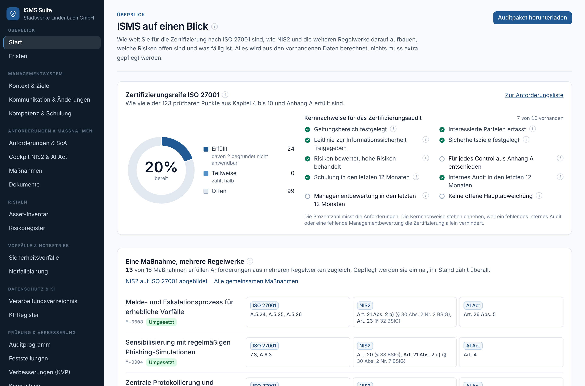

# ISMS-Suite für ISO 27001

**Ein Managementsystem für Informationssicherheit nach ISO 27001. NIS2 und der EU AI Act bauen
darauf auf, ohne dass Sie etwas doppelt pflegen.**



## Was die Suite kann

- **Programme statt Kataloge:** Das Lagebild zeigt ISO 27001, NIS2 und den EU AI Act mit Stand,
  Schritten und dem nächsten Schritt. Die Schritte ergeben sich aus den Daten, niemand hakt sie ab.
- **ISO 27001 im Mittelpunkt:** Jeder der 123 prüfbaren Punkte hat seinen Platz. Das Programm
  ISO 27001 führt Schritt für Schritt zur Zertifizierung und zeigt, welche Kernnachweise fehlen.
- **NIS2 obendrauf:** Ein Cockpit zeigt jede NIS2-Pflicht mit BSIG-Paragraf, die passenden
  ISO-27001-Controls und die Maßnahmen, die sie erfüllen. Dazu die Meldefristen nach 24 Stunden,
  72 Stunden und einem Monat.
- **Eine Maßnahme, mehrere Regelwerke:** Die Mehrfaktor-Anmeldung erfüllt ISO 27001 A.5.17 und
  NIS2 Art. 21 Abs. 2 j) zugleich. Sie pflegen sie einmal, ihr Stand zählt überall.
- **EU AI Act:** Ein KI-Register stuft eingesetzte KI-Systeme über Fragen ein und nennt die
  Betreiberpflichten mit Fundstelle.
- **Zuschaltbar:** DSGVO (Verarbeitungsverzeichnis, Folgenabschätzung) und BSI IT-Grundschutz,
  an denselben Maßnahmen.
- **Prüfbar:** Vier-Augen-Prinzip in der Datenbank, Rollen mit Funktionstrennung, ein
  Änderungsprotokoll, das niemand glätten kann, und alle Register samt Nachweisen als Auditpaket.

## Demo starten

Sie brauchen nur [Docker Desktop](https://www.docker.com/products/docker-desktop/). Der erste
Start dauert einige Minuten.

**Mac und Linux:**

```bash
git clone https://github.com/Kico-bot/ISMS_SaaS.git && cd ISMS_SaaS
echo "ISMS_JWT_SECRET=$(openssl rand -base64 48)" >> .env
echo "ISMS_APP_MASTER_KEY=$(openssl rand -base64 32)" >> .env
docker compose up -d --build
```

**Windows (PowerShell):**

```powershell
git clone https://github.com/Kico-bot/ISMS_SaaS.git; cd ISMS_SaaS
function Get-Secret($n) { $b = New-Object byte[] $n; [Security.Cryptography.RandomNumberGenerator]::Create().GetBytes($b); [Convert]::ToBase64String($b) }
Add-Content .env "ISMS_JWT_SECRET=$(Get-Secret 48)"
Add-Content .env "ISMS_APP_MASTER_KEY=$(Get-Secret 32)"
docker compose up -d --build
```

Dann <http://localhost:8080> öffnen. Der erfundene Beispielmandant **Stadtwerke Lindenbach
GmbH** ist angelegt, mit ISO 27001, NIS2 und dem EU AI Act. Kennwort für alle Konten:
`demo-passwort-2026-lindenbach`

| Konto                                | Rolle                                             |
| ------------------------------------ | ------------------------------------------------- |
| `henrike.sallach@lindenbach.example` | ISMS-Leitung, darf fast alles                     |
| `corinna.feldt@lindenbach.example`   | Interne Auditorin, sieht alles, ändert nur Audits |

Weitere Rollen: `jorin.kessler@…` (Stellvertretung), `bastian.olwig@…` (Verantwortlicher für
Systeme und Risiken), `ilka.norgaard@…` (Datenschutzbeauftragte).

**Für eine Präsentation:** Der [Demo-Leitfaden](docs/demo-leitfaden.md) führt in 25 Minuten
durch die Verknüpfung von ISO 27001 und NIS2.

**Beenden:** `docker compose down`. Mit `docker compose down -v` beginnt der nächste Start
wieder mit frischen Demodaten.

## Eigener Betrieb

Für den Einsatz in Ihrer Organisation (eigener Server, eigene Adresse, ohne Demodaten, E-Mail
für Einladungen) gibt es eine Schritt-für-Schritt-Anleitung: [INSTALLATION.md](INSTALLATION.md).

## Dokumentation

| Dokument                                                      | Wofür                                                |
| ------------------------------------------------------------- | ---------------------------------------------------- |
| [Demo-Leitfaden](docs/demo-leitfaden.md)                      | Vorführung: ISO 27001 und NIS2, gemeinsame Maßnahmen |
| [Installation](INSTALLATION.md)                               | Eigener Server, E-Mail, Einladungen                  |
| [ISO 27001: Wo wird was erfasst?](docs/iso27001-abdeckung.md) | Alle 123 Normpunkte und ihr Platz in der Suite       |
| [Deployment und Betrieb](docs/deployment.md)                  | Alle Einstellungen, Datensicherung, Fehlersuche      |
| [Technische Dokumentation](docs/technik.md)                   | Aufbau, Entwicklungsumgebung, Tests                  |
| [Screenshots](docs/produkt-screenshots/)                      | Bilder aller Bereiche                                |
| [Offene Punkte](docs/offene-punkte.md)                        | Prüfaufträge und bekannte Lücken                     |

## Lizenz

Copyright (C) 2026 Kristian Dabic. [PolyForm Internal Use License 1.0.0](LICENSE): kostenlos
für den Einsatz in der eigenen Organisation. Wer die Suite bei Kunden einsetzt, für andere
betreibt oder weitergibt, braucht eine Lizenz. Einzelheiten: [LIZENZIERUNG.md](LIZENZIERUNG.md).
